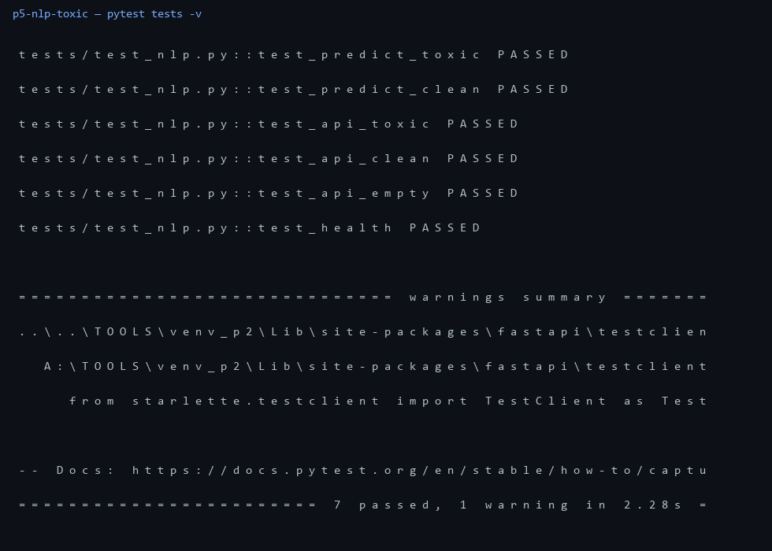

# p5-nlp-toxic — токсичность RU-комментов

Проект под вакансию с Хабр Карьеры: **NLP-разработчик**.
Честно про железо: без GPU, поэтому baseline на CPU — TF-IDF + LogReg.
След. шаг — rubert-tiny на CPU.

## что внутри

- `data/` — 64 train + 24 test, разметка 0/1
- `src/train.py` — обучение, метрики, дамп `model.joblib`
- `src/predict.py` — инференс с вероятностью
- `api.py` — `POST /api/predict` {toxic, score}, `GET /api/health` с метриками
- `Dockerfile` — обучение при сборке, запуск через uvicorn
- `tests/` — 7 тестов: метрики, оба класса, API, 422

## запуск

```bash
A:\TOOLS\venv_p2\Scripts\python -m src.train
A:\TOOLS\venv_p2\Scripts\python -m pytest tests -v
docker build -t toxic . && docker run -p 8000:8000 toxic
```

## метрики

`acc=0.958 f1=0.957` (см. `metrics.json`)

## прогон



`7 passed`
